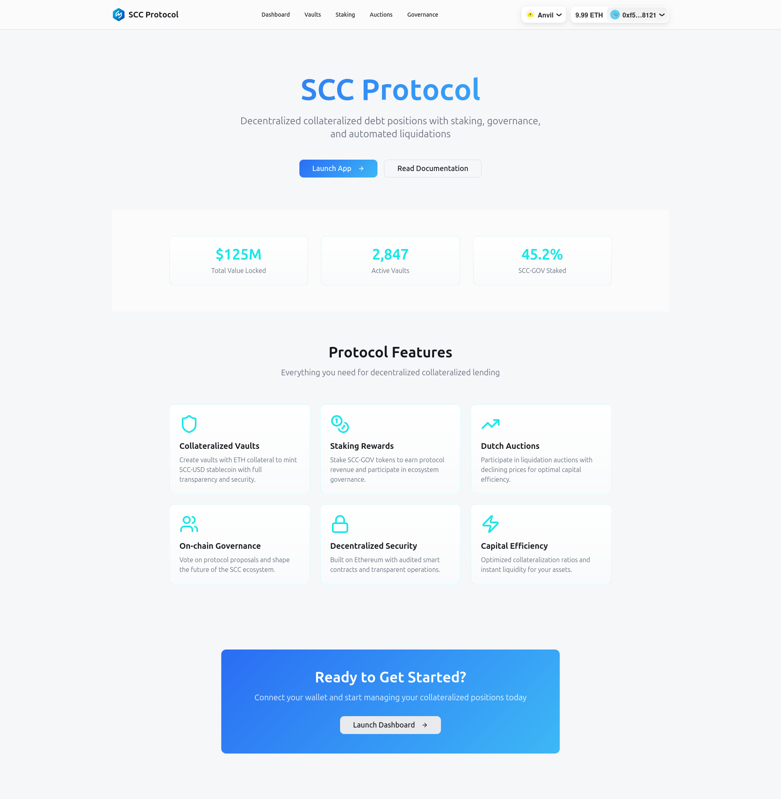
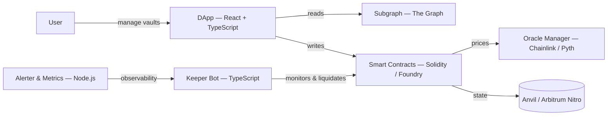

# SCC Stablecoin Protocol

[](https://github.com/machadoborges1/scc-protocol/actions/workflows/ci.yml)


This is the monorepo for the development of **SCC (Crypto-Collateralized Stablecoin)**, a decentralized stablecoin pegged to the dollar and over-collateralized by crypto assets.

The SCC Protocol allows users to deposit crypto assets as collateral in `Vaults` to mint the `SCC-USD` stablecoin. The system includes liquidation mechanisms via Dutch Auctions, a governance token (`SCC-GOV`) for community participation, and off-chain services (Keeper Bot, Subgraph) for automation and data indexing.



## Architecture



### Key components

*   **Vaults & Vault Factory** — over-collateralized debt positions represented as ERC-721 NFTs.
*   **Liquidation Manager** — Dutch auctions with linear price decay for atomic debt resolution.
*   **Oracle Manager** — price feed validation with stale-price protection.
*   **Governance** — `SCC-GOV` token + governor with time-locked proposals; protocol parameters are governable.
*   **Staking Pool** — fee distribution lifecycle for governance participants.
*   **Keeper Bot (off-chain)** — continuously monitors collateralization ratios and triggers liquidations automatically.
*   **Subgraph** — high-performance GraphQL indexing for the DApp.

## Monorepo Structure

The project is organized with `pnpm workspaces` and includes the following main components:

*   `/contracts`: Smart contracts in Solidity (Foundry).
*   `/offchain`: Off-chain services (Keeper Bot, alerter, metrics) in TypeScript/Node.js.
*   `/frontend`: User interface (DApp) to interact with the protocol.
*   `/subgraph`: Blockchain data indexing service (The Graph).
*   `/monitoring`: Observability stack configuration.
*   `/docs`: Complete project documentation.

## Local Development Environment

We use Docker Compose to orchestrate a complete and integrated development environment, including a local blockchain (Anvil), the indexer (The Graph), and all support services.

To start the environment:

```bash
docker compose up -d
```

To check and test the environment (contract deployment, subgraph, and execution of integration tests):

```bash
pnpm test:integration
```

To stop the environment:

```bash
docker compose down
```

## Testing

The contract suite runs with Foundry — **79 tests across 12 suites, all passing in CI**, covering:

*   Unit tests for every core contract (`Vault`, `VaultFactory`, `LiquidationManager`, `OracleManager`, `StakingPool`, tokens).
*   Security-focused suites (reentrancy, access control, oracle staleness, fee lifecycle).
*   Full protocol lifecycle flows: mint → borrow → liquidation auction → governance proposal → execution.

```bash
cd contracts && forge test -vvv
```

## Documentation

| Section | Contents |
| --- | --- |
| [Product & Strategy](./docs/01-product-and-strategy/01-protocol-overview.md) | Protocol overview, stablecoin mechanism, tokenomics, business model |
| [Architecture & Technical Design](./docs/02-architecture-and-technical-design/01-system-architecture.md) | System architecture, smart contracts, off-chain services, oracles, security |
| [Development & Operations](./docs/03-development-and-operations/01-development-environment.md) | Local environment, testing workflow, deployment, monitoring |
| [ADRs](./docs/02-architecture-and-technical-design/ADR/0001-Off-chain-Test-Environment-Stabilization.md) | Architecture Decision Records |

## Dive into the Documentation

For a detailed understanding of the architecture, mechanisms, tokenomics, testing workflow, and more, refer to the [complete project documentation](./docs/README.md).
